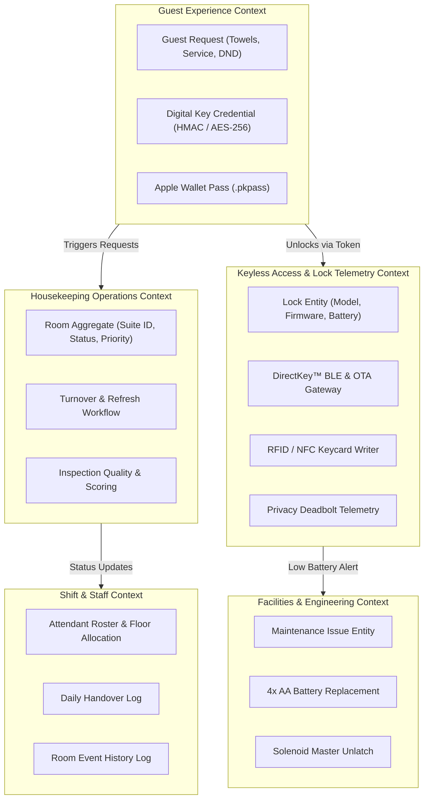
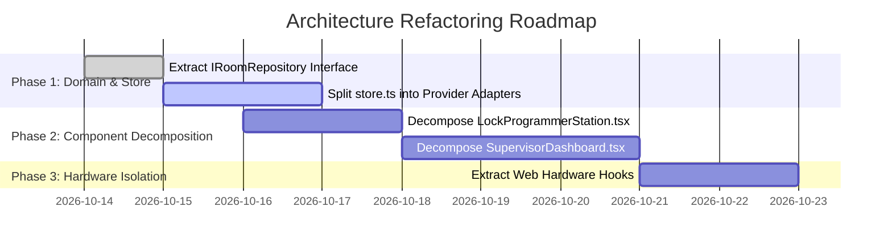

# Software Architecture Review: Extended Stay America Suites (Houston IAH)

**Date**: October 14, 2026  
**Scope**: Full Stack Hospitality Operations, Real-Time Housekeeping, Keyless Entry & Lock Telemetry  
**Methodology**: Clean Architecture, Domain-Driven Design (DDD), SOLID Principles, Component Decomposition Bar  

---

## 1. Executive Summary

This architecture review evaluates the **ESA Housekeeping** platform against enterprise Clean Architecture and Domain-Driven Design (DDD) principles. The platform serves three operational cohorts:
1. **Frontline Housekeeping Attendants**: Mobile-first rapid room turnover, multi-lingual checklists, and live tap-to-save sync.
2. **Operations Supervisors & Managers**: 3D interactive building twin, shift analytics, inspection quality scores, and real-time welfare alerts.
3. **Engineering & Security Staff**: Electronic door lock provisioning, RTC clock sync, battery telemetry, and keyless mobile entry.

### Architecture Health Scorecard

| Architectural Dimension | Current Rating | Target Bar | Gap & Assessment |
| :--- | :---: | :---: | :--- |
| **Domain-Driven Design (DDD)** | **B+** | **A** | Strong domain modeling (`RoomDoc`, `ChecklistItem`, `GuestRequest`). Needs formal Bounded Context separation between Lock Telemetry and Housekeeping Operations. |
| **Separation of Concerns (SoC)** | **B** | **A** | Business logic is partially embedded in UI event handlers. API route handlers mix storage orchestration with domain validation. |
| **Single Responsibility (SRP)** | **C+** | **A** | Monolithic components present (`SupervisorDashboard.tsx` @ 2,034 lines, `LockProgrammerStation.tsx` @ 1,249 lines). Requires decomposition into sub-atomic organisms. |
| **Dependency Inversion (DIP)** | **B** | **A** | Storage provider (`lib/store.ts`) supports dual Redis/Memory, but lacks an explicit interface contract (`IRoomRepository`). |
| **Hardware Abstraction** | **A-** | **A** | Strong multi-mode lock telemetry (DirectKey BLE, Web NFC, Serial CommLink, Apple Wallet pass). Clean hardware-agnostic payloads. |

---

## 2. Bounded Context Map (Domain-Driven Design)

The system is partitioned into five distinct Bounded Contexts:



### Context Boundary Rules
1. **Housekeeping Context**: Owns room cleanliness lifecycle (`dirty` &rarr; `in_progress` &rarr; `clean` &rarr; `inspected`). Must **never** directly invoke Web Bluetooth or Web Serial APIs.
2. **Lock Telemetry Context**: Owns lock hardware diagnostics, battery health, RTC clocks, and encryption key distribution. Interfaces with Housekeeping solely via immutable lock events (`history`).
3. **Guest Context**: Untrusted boundary. All guest tokens must be cryptographically verified (`validGuest(suite, k)`) before emitting events to other contexts.

---

## 3. Clean Architecture Layering Assessment

### Current Layer Distribution

```
┌─────────────────────────────────────────────────────────────┐
│ 1. Presentation Layer (UI Components & Pages)               │
│    - app/dashboard/page.tsx, app/lock-programmer/page.tsx   │
│    - components/SupervisorDashboard.tsx (2,034 LOC)         │
│    - components/LockProgrammerStation.tsx (1,249 LOC)       │
│    - components/DigitalKeyModal.tsx (647 LOC)               │
├─────────────────────────────────────────────────────────────┤
│ 2. Application & API Layer (Controllers & Route Handlers)    │
│    - app/api/suites/[id]/route.ts, app/api/guest/unlock     │
│    - app/api/lock-programmer/route.ts                       │
├─────────────────────────────────────────────────────────────┤
│ 3. Domain Layer (Entities, Value Objects, Business Rules)   │
│    - lib/models.ts (RoomDoc, RoomStatus, ChecklistItem)     │
│    - lib/rooms.ts (Authentic 123 Suites & Floor Coordinates)│
│    - lib/guest.ts (Token Signing & Guest Request Rules)     │
├─────────────────────────────────────────────────────────────┤
│ 4. Infrastructure Layer (Persistence, Hardware, External)   │
│    - lib/store.ts (Redis TCP / Upstash REST / Memory Fallback)│
│    - Web Bluetooth, Web NFC, Web Serial hardware drivers    │
└─────────────────────────────────────────────────────────────┘
```

### Architectural Findings & Recommendations

#### Finding 1: UI Monoliths Exceeding Component Budget
- **Problem**: `SupervisorDashboard.tsx` (2,034 lines) and `LockProgrammerStation.tsx` (1,249 lines) bundle state management, filtering logic, hardware drivers, audio synthesis, and modal rendering into single files.
- **Remediation**: Decompose into modular organisms and hooks:
  - `useLockScanner.ts` (Web Bluetooth & Web Serial state machine)
  - `useKeycardEncoder.ts` (Web NFC & card payload validation)
  - `SuiteLockMatrix.tsx` (Table organism)
  - `LockDiagnosticsCard.tsx` (Diagnostics molecule)
  - `HardwareGuideSection.tsx` (Static documentation molecule)

#### Finding 2: Direct Database Access in Route Handlers
- **Problem**: API route handlers directly call `get(suite)` and `put(suite)` with raw JSON merges, mixing persistence logic with domain invariants.
- **Remediation**: Introduce `IRoomRepository` and Domain Service functions (e.g., `RoomService.programLock(...)`, `RoomService.completeTurnover(...)`).

#### Finding 3: Concurrency & Lock Contention
- **Strength**: The codebase correctly implements `withSuiteLock(suite, fn)` per-room mutex locking, preventing race conditions during concurrent guest unlock requests and supervisor status edits.

---

## 4. SOLID Principles Compliance Analysis

| Principle | Status | Evaluation |
| :--- | :---: | :--- |
| **S - Single Responsibility** | ⚠️ **Needs Refactoring** | Components like `SupervisorDashboard.tsx` handle room filtering, table rendering, 3D card layout, staff assignment, photo preview, and modal state simultaneously. |
| **O - Open/Closed** | ✅ **Compliant** | Hotel configurations are open for extension via `HOTEL_PRESETS` in `hotel.config.ts` without modifying core engine files. |
| **L - Liskov Substitution** | ✅ **Compliant** | Storage engine transparently substitutes Redis TCP, Upstash REST HTTP, or local in-memory storage without altering consumer code. |
| **I - Interface Segregation** | ⚠️ **Partial** | `RoomDoc` interface contains 30+ properties. Clients needing only lock telemetry or room status receive the entire room aggregate. |
| **D - Dependency Inversion** | ⚠️ **Needs Interface** | Modules import concrete functions from `@/lib/store` directly rather than depending on an abstract `IRoomRepository` interface. |

---

## 5. Architectural Decision Records Index

The following Architectural Decision Records (ADRs) have been established in `docs/architecture/`:

1. **[ADR-001: Clean Architecture and Bounded Context Decoupling](./adr-001-clean-architecture-and-domain-boundaries.md)**
2. **[ADR-002: Repository Pattern and Dual-Mode Concurrency Store](./adr-002-store-repository-pattern-and-concurrency.md)**
3. **[ADR-003: Commercial Lock Telemetry & Multi-Modal Hardware Bridge](./adr-003-commercial-lock-telemetry-and-hardware-bridge.md)**
4. **[ADR-004: UI Component Decomposition Strategy](./adr-004-component-decomposition-strategy.md)**

---

## 6. Execution Roadmap


